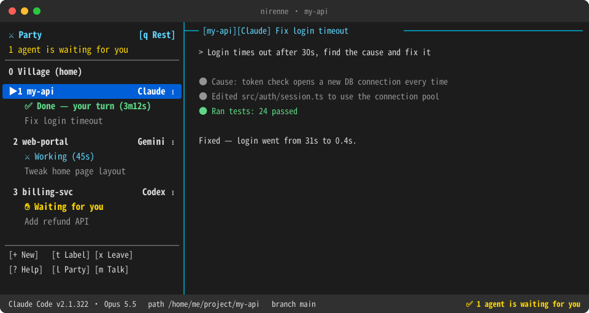

# nirenne

> **nirenne (你人呢)**: *"I'm done, where are you?"* Your AI agents call you back when they finish.

**English** | [繁體中文](README.zh-TW.md)

Manage multiple AI coding agents (Claude Code, Codex CLI, Gemini CLI, Antigravity CLI, Grok CLI) in a single terminal screen. A sidebar shows each agent's project, status and current task; click to switch. When an agent has finished and is waiting for you, it is flagged with **✅ Done — your turn** and a system notification pops up.

The problem it solves: with many terminal tabs open, it is hard to tell which tab belongs to which project and what each agent is doing, so it's easy to continue work in the wrong one.

<p align="center"></p>

## Features

- **Many agents, one screen**: click an agent in the sidebar to switch, or right-click it for a menu. With many agents, the list turns compact and scrolls.
- **Knows who is waiting for you**: each agent reports through its official hooks. Finished agents show ✅, agents that need your approval show ✋, and a Windows, macOS or Linux notification pops up.
- **See what each agent is doing**: project, Git branch, task topic, time spent, and the current version and model.
- **Keeps running in the background**: closing the terminal doesn't stop anything. Type `nirenne` to come back.
- **Parties**: pair two Claude agents so they message each other to get a job done. Each one can change only its own project ([details](docs/party.md)).
- **Hard to close by accident**: closing an agent always asks first, and an agent that exits by mistake can be restarted.
- **English / Traditional Chinese interface**: press g in the handbook ([? Help]) to switch.
- **Your usual workflow still works**: `cd project && claude` as before.

## Install

You need tmux 3.2 or later, Python 3.9 or later, bash or zsh, and at least one AI agent you have already logged in to (for example [Claude Code](https://code.claude.com/docs/en/setup)).

### Windows (WSL)

If you already have WSL and an AI agent, run these in an Ubuntu terminal:

```bash
sudo apt update && sudo apt install -y git tmux python3
git clone https://github.com/jamesbang/nirenne.git ~/nirenne
cd ~/nirenne
./install.sh
source ~/.bashrc
nirenne
```

No WSL yet, or new to the command line? Follow the [step-by-step Windows guide](docs/install-windows.md), which starts from installing WSL.

### macOS

1. Install [Homebrew](https://brew.sh/), then run `brew install git tmux python`
2. Install an AI agent (for example Claude Code) and run it once to log in
3. Install this tool:
   ```bash
   git clone https://github.com/jamesbang/nirenne.git ~/nirenne
   cd ~/nirenne
   ./install.sh
   source ~/.zshrc
   nirenne
   ```

The built-in Terminal and [iTerm2](https://iterm2.com/) both work (for iTerm2's right-click setting, see [Troubleshooting](docs/faq.md#right-click-opens-iterm2s-own-menu)).

### Linux

Same steps as WSL (use your distribution's package manager instead of `apt`); system notifications need `notify-send`.

To choose the interface language, run `./install.sh --lang en` or `./install.sh --lang zh-TW` instead of `./install.sh`. You are set when you see the agent list on the left and the "NIRENNE" title screen on the right.

## First use

1. Run `nirenne` to open the manager
2. Click [+ New] at the bottom left
3. Choose an agent type (e.g. `Claude (claude)`): click it, or select with ↑↓ and press Enter
4. Choose a project folder:
   - The list shows recently used folders plus the folders under `~/project`, `~/projects`, `~/src`, `~/code`, `~/workspace`
   - If yours is missing, choose the last entry, "Other path… (type it)", type the path (for example `~/my-app`) and press Enter. Tab completes the path, and you can also drag the folder in
5. Claude starts on the right. If it asks whether you trust this folder, press ↓ to select "Yes, I trust this folder" and press Enter
6. Type your request into Claude's input box on the right and press Enter

✅ What success looks like: your project appears in the sidebar. While Claude works it shows `⚔ Working (seconds)`, and when it is done, `✅ Done — your turn`.

Repeat steps 2–6 to open more agents; click a project name in the sidebar to switch.

## Everyday use

```bash
nirenne          # open the manager, or reattach to it
nirenne stop     # stop the manager and every agent in it (asks first)
```

- Click [q Rest] at the top right, or just close the terminal. Agents keep running in the background; type `nirenne` to come back
- ⚠️ Shutting down or restarting the computer ends the manager and every agent. After you summon them again, Claude can pick up earlier conversations with `/resume`
- Sidebar keys: `n` new, `t` label, `x` leave, `l` party, `m` talk, `?` help. Right-click an agent (or click ⋮) for its menu

### Status

| Status | Meaning |
|---|---|
| `✅ Done — your turn (3m12s)` | Done and waiting for you; the time this task took |
| `✋ Waiting for you` | The agent needs your approval, or is asking you a question |
| `⚔ Working (25s)` | Still working; elapsed time in parentheses |
| `✨ Summoning` | The agent was just summoned and is starting up |
| `💤 Standing by` | Started and waiting for your first input |
| `⏳ Waiting for app` | In a party: waiting for its partner to report back (not for you) |
| `🏹 Squads out ×2` | The main task sent out background subtasks (squads) and is waiting for them (not for you) |

For every key and control, using agents without the manager, and customizing, see [Usage](docs/usage.md).

## More documentation

| Document | Contents |
|---|---|
| [Step-by-step Windows guide](docs/install-windows.md) | From installing WSL to opening the manager |
| [Usage](docs/usage.md) | Every key and control, using agents without the manager, customizing, what the installer changes |
| [Parties](docs/party.md) | Letting two Claude agents talk: forming a party, the rules, isolation and its limits |
| [Troubleshooting](docs/faq.md) | Common problems, notification settings, known limitations |
| [Changelog](CHANGELOG.md) | Changes in each version |
| [Security policy](SECURITY.md) | How to report a vulnerability |

## Updating and uninstalling

```bash
cd ~/nirenne && git pull && ./install.sh    # update to a new version
cd ~/nirenne && ./uninstall.sh              # uninstall
```

`nirenne --version` shows the installed version. For update details and what the installer changes, see [Usage](docs/usage.md#updating-and-uninstalling).

## How this project was built

This project was developed with the help of an AI coding assistant (Claude Code); all features were designed, reviewed and tested by the author.

## License

[MIT](LICENSE) © 2026 jamesbang
