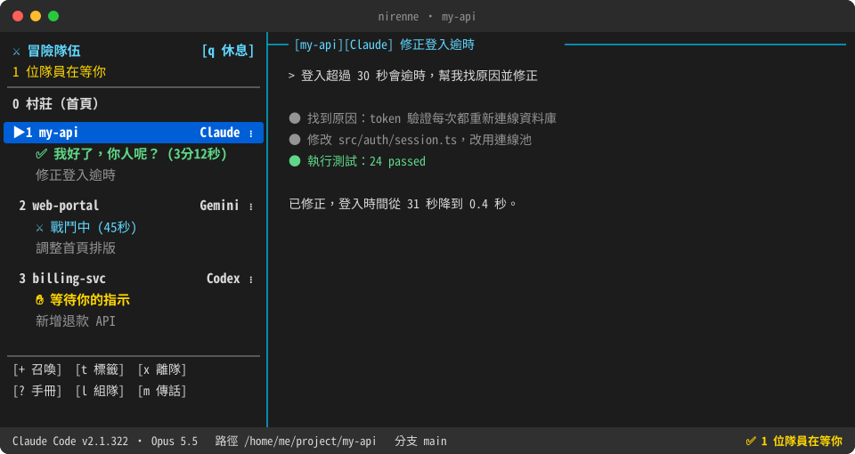

# nirenne

> **nirenne（你人呢）** —— 「我好了，你人呢？」AI Agent 做完工作，會回頭來找你。

[English](README.md) | **繁體中文**

在同一個終端機畫面中管理多個 AI coding agent（Claude Code、Codex CLI、Gemini CLI、Antigravity CLI、Grok CLI）：左側清單顯示每個 Agent 的專案、狀態與任務主題，滑鼠點一下即可切換；Agent 做完在等你時會標示「✅ 我好了，你人呢？」，並跳出系統通知。

解決的問題：開了很多終端機分頁後，分不清楚哪個分頁是哪個專案、正在做什麼，容易拿錯 Agent 繼續工作。

<p align="center"></p>

## 功能

- **一個畫面管理多個 Agent**：左側清單點一下就切換，也可以按右鍵開選單。Agent 很多時，清單會自動精簡、可以捲動。
- **自動判斷誰在等你**：透過各 Agent 的官方 hooks 回報，做完標示 ✅、需要你核准標示 ✋，並跳出 Windows／macOS／Linux 的系統通知。
- **一眼看出在做什麼**：每個 Agent 的專案、Git 分支、任務主題、花費時間，以及目前的版本與模型。
- **複製回覆**：在 Agent 上按右鍵選「複製回覆」，就能複製它的回覆或其中的程式碼原文，也可以只選其中一段。很長的 SQL、程式碼不必再用滑鼠拖曳選取（支援 Claude、Codex、Grok、Antigravity）。
- **背景持續執行**：關掉終端機也不會中斷，再輸入 `nirenne` 就能接回。
- **協作組**：把兩個 Claude 綁成一隊互相傳訊合作，各自只能改自己的專案（[說明](docs/party.zh-TW.md)）。
- **防誤關**：關閉 Agent 一定會先確認。Agent 不小心結束時，可以選擇重新啟動。
- **繁體中文／English 介面**：在冒險手冊（[? 手冊]）按 g 切換。
- **保留原本用法**：`cd 專案 && claude` 照常可用。

## 安裝

需要：tmux 3.2 以上、Python 3.9 以上、bash 或 zsh，以及至少一個已登入的 AI Agent（例如 [Claude Code](https://code.claude.com/docs/en/setup)）。

### Windows（WSL）

已經有 WSL 和 AI Agent 的話，在 Ubuntu 的終端機依序輸入：

```bash
sudo apt update && sudo apt install -y git tmux python3
git clone https://github.com/jamesbang/nirenne.git ~/nirenne
cd ~/nirenne
./install.sh
source ~/.bashrc
nirenne
```

還沒有 WSL，或不熟悉指令？請看 [Windows 完整安裝教學](docs/install-windows.zh-TW.md)，從安裝 WSL 開始一步一步帶你做。

### macOS

已經有 [Homebrew](https://brew.sh/)，並安裝好 AI Agent（例如 Claude Code）、執行過一次完成登入的話：

```bash
brew install jamesbang/tap/nirenne
nirenne-setup
source ~/.zshrc
nirenne
```

也可以從原始碼安裝：

1. 安裝 [Homebrew](https://brew.sh/)，再執行 `brew install git tmux python`
2. 安裝 AI Agent（例如 Claude Code），並先執行一次完成登入
3. 安裝本工具：
   ```bash
   git clone https://github.com/jamesbang/nirenne.git ~/nirenne
   cd ~/nirenne
   ./install.sh
   source ~/.zshrc
   nirenne
   ```

內建的「終端機」或 [iTerm2](https://iterm2.com/) 都可以用（iTerm2 的右鍵設定見[常見問題](docs/faq.zh-TW.md#iterm2-按右鍵跳出-iterm2-自己的選單)）。

### Linux

步驟和 WSL 一樣，只要把 `apt` 換成你的發行版用的套件管理工具。系統通知需要 `notify-send`。

想指定介面語言時，把 `./install.sh` 改成 `./install.sh --lang zh-TW` 或 `./install.sh --lang en`。看到左邊是 Agent 清單、右邊是「NIRENNE」標題畫面就成功了。

## 第一次使用

1. 輸入 `nirenne` 開啟管理畫面
2. 用滑鼠點左下角的 [+ 召喚]
3. 選 Agent 類型（例如 `Claude (claude)`）：用滑鼠點，或用 ↑↓ 選好按 Enter
4. 選專案資料夾：
   - 清單會列出最近用過的資料夾，以及 `~/project`、`~/projects`、`~/src`、`~/code`、`~/workspace` 底下的資料夾
   - 找不到的話，選最下面的「其他路徑…（手動輸入）」，輸入路徑（例如 `~/my-app`）再按 Enter。輸入時可以按 Tab 自動補完，也可以直接把資料夾拖曳進來
5. 右邊會開始執行 Claude。如果 Claude 問你是否信任這個資料夾，按 ↓ 選「Yes, I trust this folder」再按 Enter
6. 在右邊 Claude 的輸入框輸入你的需求，按 Enter

✅ 成功的樣子：左側清單出現你的專案。Claude 工作時顯示 `⚔ 戰鬥中 (秒數)`，做完顯示 `✅ 我好了，你人呢？`。

要開更多 Agent，重複步驟 2～6 就好。點左側清單的專案名稱就能切換。

## 常用操作

```bash
nirenne          # 開啟管理畫面，或接回原本的畫面
nirenne stop     # 結束管理畫面與其中所有 Agent（會先確認）
```

- 點右上角的 [q 休息]，或直接關掉終端機，Agent 都會繼續在背景執行。再輸入 `nirenne` 就能接回
- ⚠️ 電腦關機或重新開機後，管理畫面和所有 Agent 都會結束。重新召喚後，Claude 可以用 `/resume` 接回之前的對話
- 左側清單的按鍵：`n` 召喚、`t` 標籤、`x` 離隊、`l` 組隊、`m` 傳話、`?` 手冊。在 Agent 上按右鍵（或點 ⋮）可以開指令選單

### 狀態說明

| 狀態 | 意思 |
|---|---|
| `✅ 我好了，你人呢？ (3分12秒)` | 做完了，在等你；括號是這次花的時間 |
| `✋ 等待你的指示` | Agent 要你核准某個操作，或在問你問題 |
| `⚔ 戰鬥中 (25秒)` | 還在處理，括號是目前已花的時間 |
| `✨ 召喚中` | Agent 剛召喚出來，正在啟動 |
| `💤 待命中` | 已啟動，還沒交代工作，等你輸入 |
| `⏳ 等 app 回報` | 組隊中：在等隊友回報（不是在等你） |
| `🏹 分隊出征中 ×2` | 主任務派出背景子任務（分隊），正在等它們回來（不是在等你） |

所有按鍵與操作、不用管理畫面的用法、自訂方式，請看[使用說明](docs/usage.zh-TW.md)。

## 更多文件

| 文件 | 內容 |
|---|---|
| [Windows 完整安裝教學](docs/install-windows.zh-TW.md) | 從安裝 WSL 開始的逐步教學 |
| [使用說明](docs/usage.zh-TW.md) | 所有按鍵與操作、不用管理畫面的用法、自訂、安裝會修改哪些檔案 |
| [協作組](docs/party.zh-TW.md) | 讓兩個 Claude 互相溝通：組隊方式、協作規則、隔離方式與限制 |
| [常見問題](docs/faq.zh-TW.md) | 疑難排解、通知設定、已知限制 |
| [更新紀錄](CHANGELOG.zh-TW.md) | 各版本的變更 |
| [資安政策](SECURITY.md) | 如何回報漏洞 |

## 更新與移除

```bash
cd ~/nirenne && git pull && ./install.sh    # 更新到新版
cd ~/nirenne && ./uninstall.sh              # 移除
```

用 Homebrew 安裝的話：

```bash
brew upgrade nirenne && nirenne-setup                 # 更新到新版
nirenne-uninstall && brew uninstall nirenne           # 移除
```

`nirenne --version` 可以查看目前的版本。更新的細節與安裝會修改哪些檔案，請看[使用說明](docs/usage.zh-TW.md#更新與移除)。

## 開發方式

本專案在 AI 程式助理（Claude Code）的輔助下開發，所有功能都由作者規劃、審閱並實際測試。

## 授權

[MIT](LICENSE) © 2026 jamesbang
